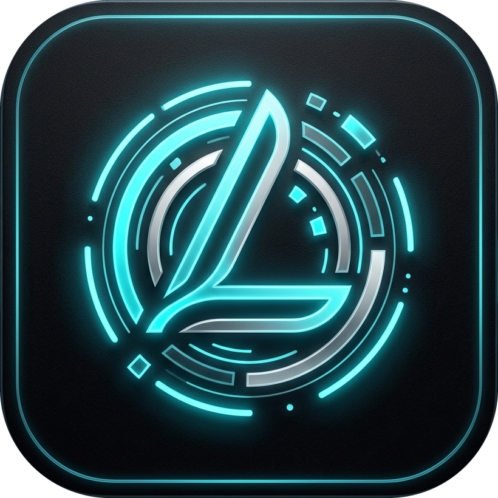

<div align="center">



# LimitlyAI

**Real-time AI Quota, Token & Expense Monitor for Google Antigravity**  
*Информативный и элегантный мониторинг лимитов, токенов и затрат в реальном времени для Antigravity 2.0*

[](https://github.com/AEISEK/LimitlyAI)
[](https://python.org)
[](#)
[](LICENSE)

---

</div>

## 🌟 О проекте

**LimitlyAI** — встроенный UI-плагин боковой панели (Auxiliary Pane) для **Google Antigravity 2.0**. Он позволяет в реальном времени отслеживать остаток квот моделей (Gemini 3.8 Flash, Claude, Codex), оценивать расход токенов и эквивалентные затраты в долларах, анализировать темп работы и видеть точный обратный отсчёт до сброса лимитов прямо внутри интерфейса IDE.

Плагин выполнен в строгом **минималистичном монохромном стиле** (серебристо-серые оттенки, табличные цифры `tabular-nums`, деликатные микробордеры), идеально гармонирующем с тёмной темой Antigravity.

---

## ✨ Ключевые возможности

* 🧠 **Память агента и сводка заполнения (Agent Memory)**: Мониторинг размера активного контекстного окна диалога (`Xk / 260k токенов · X%`), детализация по кэшированным и новым входным токенам последнего шага, а также своевременная сводка-предупреждение с рекомендацией вызвать `/compact` до автоматической обрезки контекста.
* 📁 **Персональный лимит памяти для каждого проекта (`.limitlyai.json`)**: Автоматическое определение рабочего каталога проекта активного диалога. Считывание персонального лимита из `.limitlyai.json` в корне проекта (например, `{"memory_limit": "200k"}`), а также мгновенная смена лимита в один клик прямо из карточки интерфейса с автоматическим созданием/обновлением файла конфигурации проекта.
* ⏱ **Точные таймеры до секунды**: Отображение динамического обратного отсчёта до сброса 5-часовых и недельных квот (`Сброс: 2ч 14м 30с`).
* 💰 **Подсчёт токенов и стоимости ($)**: Калькулятор общего объёма сгенерированных токенов и оценка стоимости по официальным тарифам Google Developer API для `gemini-3.8-flash` ($0.75 вход / $3.75 выход за 1M токенов, ~$1.75/1M blended).
* 🔥 **Темп расхода и прогноз (Burn Rate & Runway)**: Вычисление скорости сжигания квоты (`~X.X% / ч`) за скользящее часовое окно и прогноз: *«Хватит до сброса ✓»* или расчетное время до исчерпания.
* 📊 **График активности (4 часа)**: 8-колоночная гистограмма потребления квоты с шагом 30 минут и всплывающими подсказками.
* 📝 **Лог последних списаний (Activity Feed)**: Журнал недавних событий списания квоты с точным временем, дельтой (`-2.4%`), объёмом токенов (`~24k`) и долларовым эквивалентом (`$0.04`).
* 🗂 **Интерактивный аккордеон**: Мгновенное (0 мс) сворачивание и разворачивание любой карточки кликом по ней с сохранением компактного превью ключевых цифр.
* 🎛 **Два режима отображения**: Переключение в один клик между компактным однострочным видом (`Compact`) и подробными карточками (`Cards`).
* ⚡ **Выбор интервала автообновления**: Выпадающий список интервалов: `10с`, `15с`, `30с`, `60с` с возможностью принудительного обновления вручную.
* 💾 **Полная персистентность**: Все настройки (выбранный фильтр, режим отображения, интервал автообновления, свернутые секции) сохраняются в `localStorage` и файле конфигурации сервера.
* 🔒 **100% приватность**: Плагин общается исключительно с локальным процессом Language Server Antigravity по внутреннему адресу `127.0.0.1` с CSRF-токеном авторизации. Никаких внешних серверов и утечек кода.

---

## 🚀 Быстрая установка

### Автоматическая установка через PowerShell

Выполните одну команду в PowerShell:

```powershell
# 1. Клонируем репозиторий в папку плагинов Antigravity
git clone https://github.com/AEISEK/LimitlyAI.git "$env:USERPROFILE\.gemini\config\plugins\limitlyai"

# 2. Копируем в директорию сайдкаров для запуска панели
Copy-Item -Recurse -Force "$env:USERPROFILE\.gemini\config\plugins\limitlyai" "$env:USERPROFILE\.gemini\config\sidecars\limitlyai"
```

После этого откройте боковую панель в Antigravity 2.0:
> Нажмите на иконку LimitlyAI в боковой панели или перейдите по ссылке `sidecar://limitlyai/`.

---

## 🛠 Структура репозитория

```
LimitlyAI/
├── plugin.json         # Манифест плагина Antigravity 2.0
├── sidecar.json        # Конфигурация веб-сервиса и точки входа Aux Pane
├── server.py           # Локальный Python HTTP-сервер с авторизацией в Language Server
├── static/             # Веб-интерфейс плагина
│   ├── index.html      # Разметка боковой панели
│   ├── style.css       # Монохромные стили и анимации
│   ├── app.js          # Логика опроса, расчёта метрик и рендеринга
│   └── logo.svg        # Векторный логотип
├── assets/             # Графические ресурсы и иконки
├── .gitignore          # Исключения Git
├── LICENSE             # Лицензия GNU General Public License v3.0
└── README.md           # Документация проекта
```

---

## 📄 Лицензия

Проект распространяется под свободной лицензией **GNU General Public License v3.0**. Подробности в файле [LICENSE](LICENSE).
